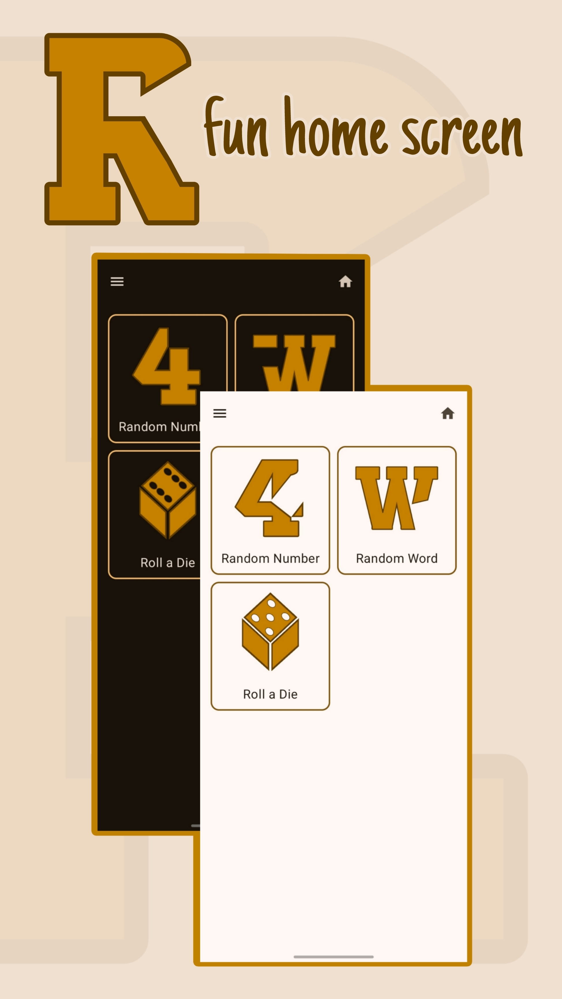
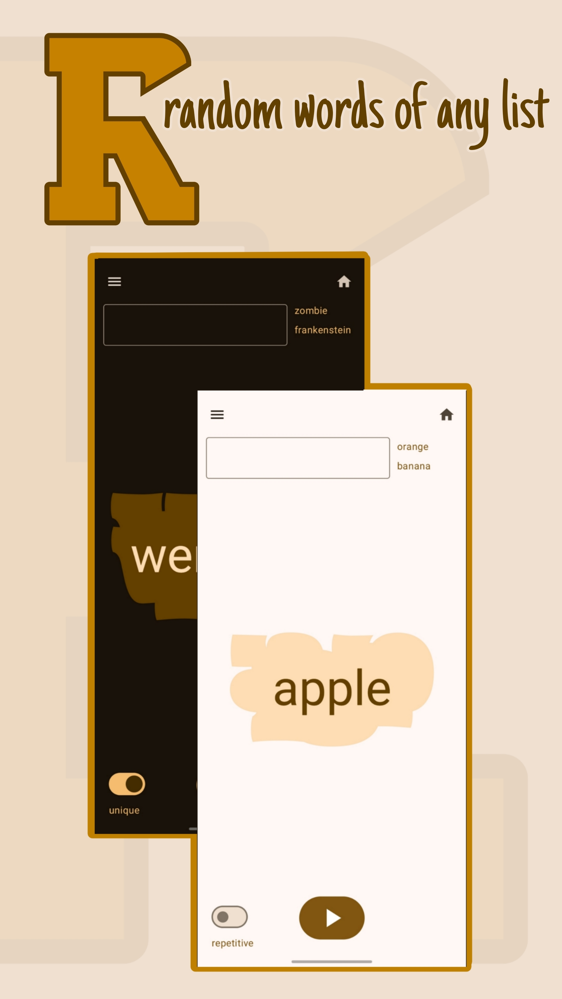
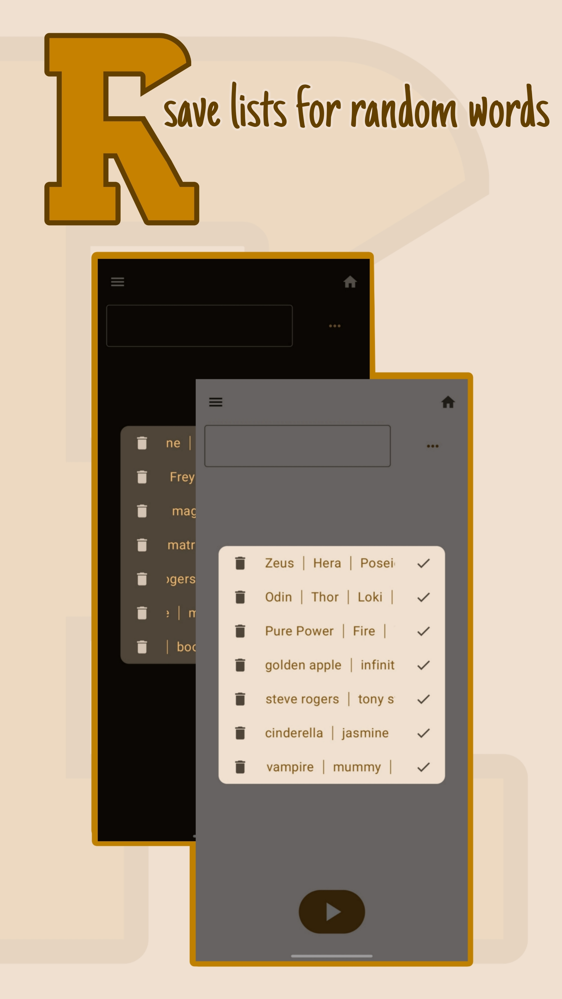
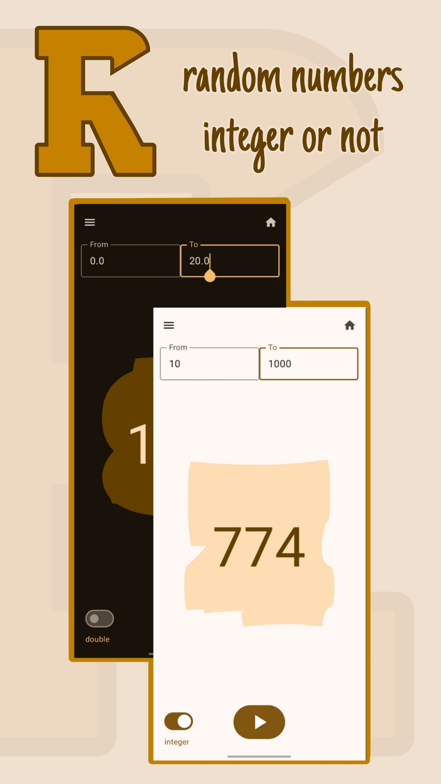
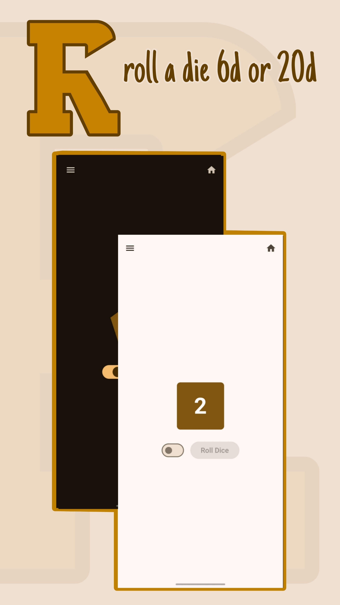

# Randomizer
### What's better than a die roll?
### a die roll that gives more than 6 ;)
##### This app is programmed in a way that can produce any kind of random item **you can imagine**.
#
##### 
### Things this app could solve:
#### 1. Your indecisiveness between options:
- [ ] eat pizza
- [ ] go to the gym
- [x] sleep in the afternoon
- [ ] watch movie
##### 
> *with your own preferred lists*
##### 
#### 2. Not having a single number among many:
> should I choose 14 or 38? 🤔
##### 
#### 3. Not knowing what score you should give your students:
##### *just hit the button and the app would probably give you something like this: 4.39*
#### 4. Having to carry a die around:
##### *6 sided or 20 sided*
##### 
#
### **Three features in three versions already!**
#### *Try this Android app and give feedback*
#### **Help me make it perfect**
#
### Download the apk here 👇
[Android version](https://github.com/MotamedKia/Randomizer/releases/download/apk/app-release.apk)
